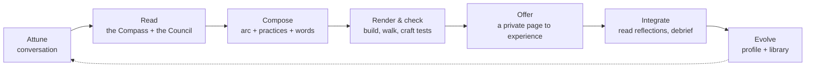

# Inner Sky: design

> The sky is always there behind the weather.

An image shared by many contemplative traditions: thoughts and feelings are weather, and awareness
is the sky. Inner Sky is a workflow that takes *today's weather* (how you are right now, what's
going on, what you think you need) and produces a personalized, interactive experience that helps
you move toward more clarity, agency, ease, understanding or aliveness, whichever this moment calls for.

## What it is

A pipeline with a person at both ends:

1. **Attune.** A short conversation with Claude: body, mood, mind, context, stated need, time,
   setting, depth. Not a form, but a real listening exchange, with a safety screen.
2. **Read.** Claude writes a *Reading*: nervous-system state, stated vs. sensed need, the one
   *movement* needed (Settle, Feel, Understand, Release, Reclaim, Orient, Nourish, Enliven, Connect,
   Savor), the growing edge, and a throughline image. It consults a **council of 5–7 lenses**
   drawn from ~30 traditions (somatic, Focusing, IFS, ACT, Stoicism, Buddhist and Taoist practice,
   narrative therapy, positive psychology, coaching, play, poetry…), each saying what it sees and
   what it would offer.
3. **Compose.** Claude weaves those lenses into one passage with a dramaturgical arc (Arrive →
   Settle → Meet → Turn → Integrate → Return), written in the person's own words, with choice points,
   a live companion moment and a closing card. The output is a script (`experience.json`).
4. **Render and check.** The engine turns the script into a page. The build validates it and
   estimates timing; a headless walk-through screenshots every step; the craft tests catch generic
   lines, weak arcs and safety issues before anything ships.
5. **Offer.** The page is published as a private Artifact on claude.ai, ready on phone or desktop.
6. **Integrate.** The page saves reflections and before/after measures privately. When you come
   back, Claude reads them, debriefs with you, and records what landed.
7. **Evolve.** A personal profile accumulates what helps and what doesn't. Patterns across
   sessions improve the library and the engine.

## Why it should work reliably

Most "wellness content" is generic: the same breathing exercise for everyone, regardless of state.
Reliability here comes from five design decisions:

- **State before content.** The Compass decides *what kind of shift* is needed before choosing
  any practice. An activated nervous system gets regulated first; a shut-down one gets gently
  upshifted; only an open one goes deep. Mismatching state and practice is the most common
  reason these things fail.
- **A real arc, not a list.** Experiences have dramaturgy: a threshold, safety before depth,
  pendulation between hard and resourced, one designed Turn at about two-thirds, and a lighter
  ending with agency. That's how rituals, good therapy sessions and good theater work.
- **Many lineages, woven.** Each tradition sees something the others miss. The council prevents
  one-note sessions, and the weaving keeps it coherent: one throughline, not a sampler.
- **Specificity.** The person's own words echo back, both from intake and from what they write
  during the experience. The companion (live Claude inside the page) responds to what is actually
  there. A craft standard rejects any line that could have been written for anyone.
- **A feedback loop.** Every experience measures before and after on the dimension it targets, and
  asks what landed. The profile turns one-off sessions into a practice that gets better at
  knowing you.

## The parts

| Path | What it is |
|---|---|
| `.claude/skills/session/SKILL.md` | the workflow Claude follows to run a session (type `/session`) |
| `library/compass.md` | how to read the moment and write the Reading |
| `library/lenses.md` | the council: ~30 traditions, their questions, moves and cautions |
| `library/practices.md` | the atlas: ~60 practices mapped to engine steps |
| `library/arcs.md` | dramaturgy: pacing principles and nine arc patterns |
| `library/craft.md` | voice, words to avoid, and the nine tests every experience must pass |
| `library/safety.md` | red flags, trauma-informed defaults, cautions, privacy |
| `engine/template.html` | the experience player: a living sky, synthesized sound, 13 step types |
| `engine/skies.json` | 15 sky states the arc moves through |
| `engine/SCHEMA.md` | the script format |
| `tools/build.mjs` | validates a script, estimates timing, builds the page |
| `tools/preview.mjs` | walks an experience in headless Chromium and screenshots each step |
| `examples/sample/` | a complete example experience |
| `private/` | your sessions, reflections and profile (git-ignored while the repo is public) |

## The experience engine

One page, no dependencies besides fonts. It's designed to feel like a quiet room rather than an app.

- **A living sky.** The background is a canvas sky that moves through the arc (overcast → after
  rain → clearing → golden), so the visual journey mirrors the inner one. Night skies have stars.
- **Sound.** A soft synthesized drone with moving air that swells with the breath, and a
  singing-bowl bell at each new movement. Optional voice guidance uses the browser's speech.
- **A demonstrating figure.** Movements are shown by a simple animated figure that moves in time
  with the cues and breath, and previews the whole sequence before you start.
- **Natural voices.** Voice guidance prefers natural voices (Andrew, Ryan and others in Microsoft
  Edge; Enhanced and Premium voices on Apple devices), with a voice picker on the first screen.
- **Freedom by default.** The first screen says you can change anything: adjust a stretch, sing
  instead of playing a song, skip or invent.
- **Look back.** After the closing card, every step can be revisited and marked helped / okay /
  didn't help, with a note. Claude reads that feedback when you come back.
- **13 step types**: threshold, text, breath (animated orb with 7 patterns), guided (timed cues),
  sit, write (with an optional flow timer), choose, words, scale, body map, release (your words
  dissolve), companion (live Claude) and the closing card.
- **Branching** with `when`, and **echoes** of what you've written with `{{stepId}}`.
- **Always-there steady button**: pauses everything and offers grounding and crisis resources.
- **Private by design**: reflections save to the artifact's owner-only database; `private` steps
  and released text never leave the device.

## Roadmap

Ideas for after the first few sessions, guided by what you find helpful:

- **Real narrated audio.** Generate a calm human-sounding voice track for guided parts (the
  Higgsfield connector can generate audio), instead of browser speech.
- **A personal image.** Generate one image per experience: the symbol or landscape of the throughline.
- **A home page.** One persistent page holding the profile, the history of experiences and the
  measures over time, so it survives across sessions without git.
- **Journeys.** Multi-session arcs (a week of mornings, a transition, a recurring theme).
- **A quick check-in page.** A 60-second intake you can fill on your phone, so Claude can build
  while you're getting settled.
- **A council of agents.** For bigger moments, ask several subagents, each speaking for a different
  tradition, to propose a Turn, and let a final pass weave them.
- **Scheduled sessions.** A morning or evening prompt that starts the conversation for you.
